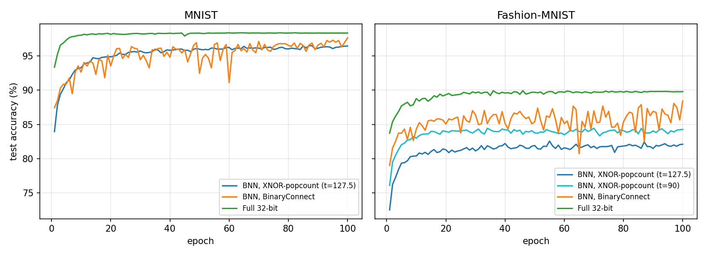

# Binary Neural Network with XNOR-Popcount Inference on CUDA

[](https://doi.org/10.54644/jte.2025.1756)
[](LICENSE)
-76B900)

A from-scratch reimplementation of the binary neural network (BNN) from our paper
**"Optimizing Binary Neural Network for Resource-Constrained Edge Devices in IoT Applications"**
(*Journal of Technical Education Science*, vol. 21, no. 1, 2026). The original code is no longer
available, so this repository (`-new`) rebuilds it from the paper and improves it: training with 1-bit
weights and activations using batch normalization, Adam and a cross-entropy loss, then inference with the
bit-packing + XNOR-popcount scheme of the paper's Algorithm 2, running as a fused CUDA kernel on an
NVIDIA GeForce RTX 3060. The fully binary network now reaches **96.43%** on MNIST (80.82% in the paper)
and runs at about 32 million images per second, 4.4–4.7× faster than the 32-bit network on the same GPU.

> [!IMPORTANT]
> **If you use this code, please cite the paper:**
>
> V. M. Nguyen, T. T. Ngo, T. D. Tran, M. T. Nguyen, and M. H. Vo, "Optimizing binary neural network for
> resource-constrained edge devices in IoT applications," *Journal of Technical Education Science*,
> vol. 21, no. 1, pp. 12–22, Feb. 2026, doi: [10.54644/jte.2025.1756](https://doi.org/10.54644/jte.2025.1756).
>
> BibTeX is in [How to cite](#how-to-cite). GitHub's **"Cite this repository"** button exports it too.

## Results

All numbers below were measured with this code on an NVIDIA GeForce RTX 3060. The "Original paper"
values are Tables 2 and 3 of the paper. This version uses an improved training recipe (see
[What is new](#what-is-new-compared-with-the-original-paper)), and **every configuration is more
accurate than in the original paper**.

### Accuracy

Test accuracy on the 10,000 test images after the last of 100 epochs (no early stopping, single seed).

| Dataset | Model | W/A bits | Input threshold | **This version (%)** | Original paper (%) | Gain (points) | Memory (KB) |
|---|---|---|---|---|---|---|---|
| MNIST | BNN, XNOR-popcount | 1/1 | 127.5 | **96.43** | 80.82 | **+15.61** | 52.7 |
| MNIST | BNN, BinaryConnect | 1/32 | – | **97.62** | 88.13 | **+9.49** | 49.6 |
| MNIST | Full 32-bit | 32/32 | – | **98.32** | 96.55 | **+1.77** | 1590.0 |
| Fashion-MNIST | BNN, XNOR-popcount | 1/1 | 127.5 | **82.11** | 67.16 | **+14.95** | 52.7 |
| Fashion-MNIST | BNN, XNOR-popcount | 1/1 | 90 | **84.27** | 70.99 | **+13.28** | 52.7 |
| Fashion-MNIST | BNN, BinaryConnect | 1/32 | – | **88.42** | 82.74 | **+5.68** | 49.6 |
| Fashion-MNIST | Full 32-bit | 32/32 | – | **89.78** | 86.77 | **+3.01** | 1590.0 |

The binary networks gain the most (+9 to +16 points), because the new recipe mainly fixes how 1-bit
networks are trained. The gap between the fully binary network and the 32-bit network shrinks from
15.7 to **1.9 points** on MNIST and from 15.8 to **5.5 points** on Fashion-MNIST. As in the paper,
threshold 90 works better than 127.5 on Fashion-MNIST. Memory for the XNOR model is the packed file
(weights with padding, integer thresholds, output scales): about **30× smaller** than the 32-bit model,
in line with the paper's 51 KB vs 1587 KB. BinaryConnect accuracy fluctuates by a few points between
epochs (see the curves), so its last-epoch value is less stable than the others.



### Runtime

Mean ± standard deviation over 5 repeated measurements (`python bench_runtime.py --repeats 5`).

| Dataset | Model | Engine | Whole test set, 10,000 images (µs/image) | One image (ms) |
|---|---|---|---|---|
| MNIST | BNN, XNOR-popcount (t=127.5) | **CUDA kernel (this repo)** | **0.0323 ± 0.0009** | **0.0107 ± 0.0013** |
| MNIST | BNN, BinaryConnect | PyTorch | 0.1544 ± 0.0020 | 0.1705 ± 0.0302 |
| MNIST | Full 32-bit | PyTorch | 0.1421 ± 0.0009 | 0.0754 ± 0.0125 |
| Fashion-MNIST | BNN, XNOR-popcount (t=127.5) | **CUDA kernel (this repo)** | **0.0311 ± 0.0002** | **0.0106 ± 0.0005** |
| Fashion-MNIST | BNN, XNOR-popcount (t=90) | **CUDA kernel (this repo)** | **0.0311 ± 0.0002** | **0.0102 ± 0.0003** |
| Fashion-MNIST | BNN, BinaryConnect | PyTorch | 0.1564 ± 0.0054 | 0.1851 ± 0.0374 |
| Fashion-MNIST | Full 32-bit | PyTorch | 0.1469 ± 0.0034 | 0.0931 ± 0.0243 |

Speed-up of the XNOR-popcount kernel:

| Compared with | Whole test set | One image |
|---|---|---|
| 32-bit model, same GPU (PyTorch, cuBLAS) | **4.4× (MNIST), 4.7× (Fashion-MNIST)** | **7.0×, 8.8–9.1×** |
| BinaryConnect model, same GPU (PyTorch) | 4.8×, 5.0× | 15.9×, 17.5–18.1× |
| XNOR-popcount in the original paper (0.0196 ms/image, laptop CPU) | about **600×** (different hardware) | – |

Throughput is about **31–32 million images per second**. For reference, the simple single-thread C++
loop that the program uses to check correctness takes 0.018–0.020 ms per image on this PC's CPU, close
to the paper's 0.0196 ms per image.

**How runtime is measured**

- Hardware and software: GeForce RTX 3060 12 GB (sm_86, 28 SMs), driver 560.94, CUDA 12.6,
  PyTorch 2.8 (CUDA 12.9 build), Windows 11. Nothing else ran on the GPU during the measurements.
- CUDA kernel (`cuda/bnn_xnor.cu`): timed with CUDA events. After 20 warm-up launches, it is launched
  200 times on the whole test set and 2,000 times on one image; the reported time is per launch divided
  by the number of images. Each launch covers the full inference: bit packing of the raw `uint8`
  pixels on the GPU, both layers and the arg-max.
- PyTorch models (`train.py --time-only`): `eval()` mode, `torch.no_grad()`, binary weights binarized
  once beforehand. After 10 warm-up passes, 50 forward passes are timed with CUDA events, for a batch
  of 10,000 images and for a batch of 1.
- In both cases the input is already on the GPU; host↔device copies are not included.
- Correctness is checked in the same run: the GPU predictions are compared with the C++ CPU reference
  and the NumPy integer path, with **0 differences out of 10,000** on all three XNOR models.

Raw numbers: [results/runtime.json](results/runtime.json) (runtime), [results/summary.json](results/summary.json) (accuracy).

### Conclusion

1. **Accuracy.** Retrained with batch normalization, Adam and a cross-entropy loss, the same 784–512–10
   networks are more accurate than in the original paper in all seven configurations, by up to
   15.6 points. The fully binary network reaches 96.43% on MNIST and 84.27% on Fashion-MNIST, close to
   the 32-bit network. The low accuracy reported in the paper came from the original training recipe
   (MSE loss, no batch normalization, no optimizer tuning), not from the BNN method itself.
2. **Memory.** With 1-bit weights packed into `uint32` words, the model takes 52.7 KB instead of
   1590 KB, about 30× less, on any hardware.
3. **Runtime.** The fused XNOR-popcount kernel classifies about 32 million images per second on an
   RTX 3060. On the same GPU it is 4.4–4.7× faster than the 32-bit model over the whole test set and
   7–9× faster for a single image, with bit-exact results. The speed-up over 32-bit is smaller than the
   roughly 40× the paper measured on a CPU, because a GPU already runs 32-bit matrix multiplication very
   efficiently; the memory saving does not depend on the hardware.
4. **Overall.** Bit packing with XNOR-popcount keeps the accuracy of a well-trained binary network while
   cutting memory by about 30× and running several times faster than 32-bit inference, which makes
   it a practical choice for resource-constrained edge and IoT devices.

## What the code does

### Network and training

The three networks of the paper (Fig. 2), all **784–512–10** fully connected:

| Model | Weights | Activations | Input |
|---|---|---|---|
| Full 32-bit | 32-bit | 32-bit (sigmoid) | normalized pixels |
| BinaryConnect | 1-bit (±1) | 32-bit (sigmoid) | normalized pixels |
| XNOR-popcount | 1-bit (±1) | 1-bit (±1) | pixels binarized at a threshold (127.5 or 90) |

Binary layers keep a real-valued *latent* weight for the optimizer and use `sign(W)` in the forward
pass. The gradient of `sign` is the straight-through estimator (STE): it passes through unchanged for
|x| ≤ 1 and is zero outside (Section 2.3 of the paper). Latent weights are clipped to [−1, 1] after every
step. Batch normalization after each binary layer (not used in the original paper) stabilizes training
and costs nothing at inference, because it folds into the integer thresholds described below.

### From a trained model to integer-only inference

`bnn/pack.py` turns the trained XNOR model into the form Algorithm 2 needs:

- **Bit packing (Eq. 3):** +1 → bit 1, −1 → bit 0. Element *i* goes to bit *i* mod 32 of `uint32` word ⌊*i*/32⌋.
  A 784-pixel image becomes 25 words; a 512-neuron hidden layer becomes 16 words.
- **XNOR-popcount:** for *n* real bits, the ±1 dot product is `n − 2·popcount(x XOR w)`, which equals
  `2·popcount(XNOR(x, w)) − n` from Algorithm 2. Padding bits are 0 in both operands, so they never count.
- **BatchNorm folding:** `sign(BN(z))` is monotonic in the integer `z`, so it becomes a single integer
  comparison `z ≥ T` per neuron. Neurons with a negative BN scale get their weight row inverted so that
  every neuron uses the same `≥` test. The output layer keeps one float scale and offset per class.

The hidden layer therefore needs no floating point at all, and the whole model is about 53 KB.
`pack.predict` is a NumPy reference of this integer-only path; it agrees with the PyTorch model on
every test image (see the bit-exactness list above).

### CUDA kernel (`cuda/bnn_xnor.cu`)

One fused kernel goes from raw `uint8` pixels to class labels. A block has 512 threads, one per hidden neuron:

1. **Bit packing on the GPU:** each of the 32 lanes in a warp tests one pixel against the threshold, and
   `__ballot_sync` packs the 32 results into one `uint32` word in a single instruction.
2. **Hidden layer:** each thread holds its neuron's 25 packed weight words in registers and computes
   `z = 784 − 2·Σ __popc(x[k] ^ w[k])`. Each XOR + `__popc` covers 32 synapses at once (SIMD within a register).
3. **Sign and re-packing:** `z ≥ T` is packed again with `__ballot_sync`, so warp *k* writes hidden word *k* directly.
4. **Output layer:** lanes 0–9 of warp 0 do the 512-bit XNOR-popcount for the 10 classes, apply the folded
   BatchNorm, and a warp-shuffle reduction picks the arg-max.

Weights are loaded once per block and reused for every image the block processes (4 images per step).
The program checks its predictions against a CPU reference and against the Python integer path, and
reports throughput for the whole test set and latency for a single image.

## What is new compared with the original paper

This repository is a **new, improved implementation**, not a copy of the original code. The network
(784–512–10), the binarization (sign + STE), the input thresholds and the XNOR-popcount inference of
Algorithm 2 are the same as in the paper. The **training recipe is new**:

| | Original paper | This version |
|---|---|---|
| Loss | mean squared error (Algorithm 1) | **cross-entropy** |
| Optimizer | plain gradient descent, learning rate 0.1, no further tuning | **Adam**, learning rate 1e-3, **cosine learning-rate decay** |
| Batch normalization | **not used** | **after every binary layer**, folded into integer thresholds for inference |
| Weight update | weights re-binarized right after every update (Algorithm 1) | real-valued latent weights kept for the optimizer, clipped to [−1, 1], binarized in the forward pass |
| Epochs / batch size | 100 / 200 | 100 / 200 (unchanged) |
| Inference | Python on an Intel Core i5-1035G1 CPU | fused CUDA kernel on an NVIDIA GeForce RTX 3060 GPU |

**Why the paper's numbers are lower.** Without batch normalization, with an MSE loss and with weights
re-binarized after every step, the original BNNs trained poorly: 80.82% on MNIST and 67.16–70.99% on
Fashion-MNIST for the fully binary network. Re-binarizing after every step also explains the jagged
training curves in the paper's Figures 3 and 4. With the recipe above, the same 784–512–10 binary
network reaches 96.43% and 84.27%. The paper's results show what the original training achieved; they
are not a limit of the BNN method itself.

Timings are not directly comparable with the paper's either: the paper measured on a laptop CPU, this
version on a GPU.

## Quick start

Requirements: an NVIDIA GPU with CUDA, the CUDA Toolkit (`nvcc`), Python 3.10+ with PyTorch.
Tested on Windows 11, RTX 3060 (sm_86), CUDA 12.6, PyTorch 2.8, Visual Studio 2022.

```bash
pip install -r requirements.txt

# build the CUDA program
cuda\build.bat                                   # Windows (finds MSVC automatically)
nvcc -O3 -std=c++17 -arch=sm_86 -o cuda/bnn_xnor cuda/bnn_xnor.cu   # Linux

# reproduce everything: 7 trainings x 100 epochs + CUDA inference, writes results/
python run_all.py

# re-measure all timings without retraining (keep the GPU otherwise idle)
python run_all.py --skip-train

# runtime table: 5 repeated measurements, mean ± std
python bench_runtime.py --repeats 5
```

For another GPU, change `-arch` (for example `sm_75`, `sm_89`), or on Windows run
`set CUDA_ARCH=sm_89` before `cuda\build.bat`.

### Run the CUDA kernel with the pretrained models

`pretrained/` contains the three packed XNOR models from the table above (about 53 KB each):

```bash
python make_testset.py pretrained/mnist_xnor_t127.5/model.bin --dataset mnist
cuda\bnn_xnor.exe pretrained/mnist_xnor_t127.5/model.bin pretrained/mnist_xnor_t127.5/testset.bin
```

### Train a single configuration

```bash
python train.py --dataset mnist   --model fp32
python train.py --dataset mnist   --model bc
python train.py --dataset fashion --model xnor --threshold 90
```

Each run writes `runs/<name>/metrics.json` (accuracy per epoch, GPU timings) and `model.pt`; XNOR runs
also write `model.bin` and `testset.bin` for the CUDA program.

## Repository layout

```
bnn/models.py        FP32, BinaryConnect and XNOR networks; sign with STE; binary linear layer
bnn/data.py          MNIST / Fashion-MNIST loading and input binarization
bnn/pack.py          bit packing, BatchNorm folding, NumPy integer-only reference, file formats
train.py             train one configuration, export packed model
run_all.py           reproduce Tables 2 and 3, write results/
bench_runtime.py     repeat the runtime measurements, write results/runtime.json
make_testset.py      build testset.bin for a packed model
cuda/bnn_xnor.cu     fused XNOR-popcount kernel, CPU reference, benchmark
cuda/build.bat       Windows build script
pretrained/          packed XNOR models (model.bin)
results/             results table, summary.json, training curves
```

## How to cite

If this code helps your work, please cite the paper:

```bibtex
@article{Nguyen2026OptimizingBNN,
  title     = {Optimizing Binary Neural Network for Resource-Constrained Edge Devices in IoT Applications},
  author    = {Nguyen, Van Minh and Ngo, Tien Tu and Tran, Tien Dung and Nguyen, Minh Tam and Vo, Minh Huan},
  journal   = {Journal of Technical Education Science},
  volume    = {21},
  number    = {1},
  pages     = {12--22},
  month     = feb,
  year      = {2026},
  issn      = {2615-9740},
  doi       = {10.54644/jte.2025.1756},
  url       = {https://doi.org/10.54644/jte.2025.1756},
  publisher = {Ho Chi Minh City University of Technology and Engineering}
}
```

**IEEE:** V. M. Nguyen, T. T. Ngo, T. D. Tran, M. T. Nguyen, and M. H. Vo, "Optimizing binary neural network
for resource-constrained edge devices in IoT applications," *Journal of Technical Education Science*,
vol. 21, no. 1, pp. 12–22, Feb. 2026, doi: 10.54644/jte.2025.1756.

**APA:** Nguyen, V. M., Ngo, T. T., Tran, T. D., Nguyen, M. T., & Vo, M. H. (2026). Optimizing binary neural
network for resource-constrained edge devices in IoT applications. *Journal of Technical Education Science*,
*21*(1), 12–22. https://doi.org/10.54644/jte.2025.1756

The paper is open access under [CC BY-NC 4.0](https://creativecommons.org/licenses/by-nc/4.0/):
[full text (PDF)](https://ohtaetu.github.io/papers/nguyen2026_bnn_jte.pdf).

## Author

Tu Tien Ngo, School of Electrical Engineering, Kookmin University · [ohtaetu.github.io](https://ohtaetu.github.io/)

## License

Code: [MIT](LICENSE). The paper itself is published by Ho Chi Minh City University of Technology and
Engineering under CC BY-NC 4.0.
